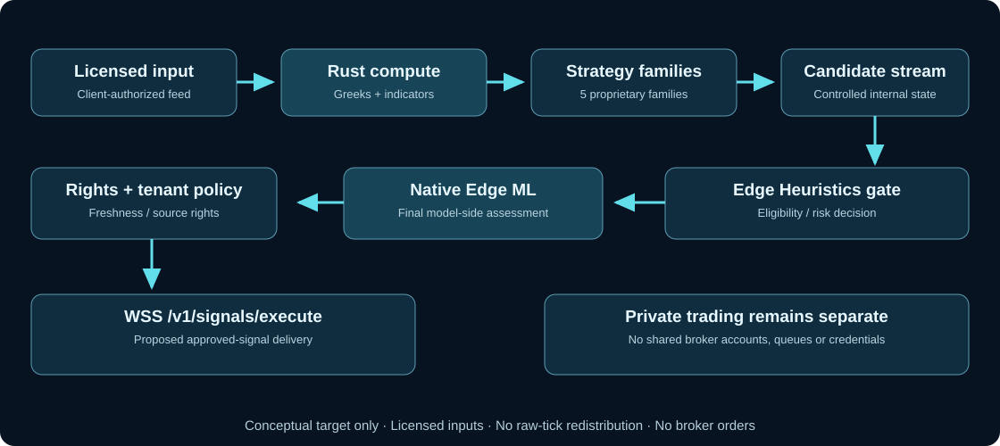
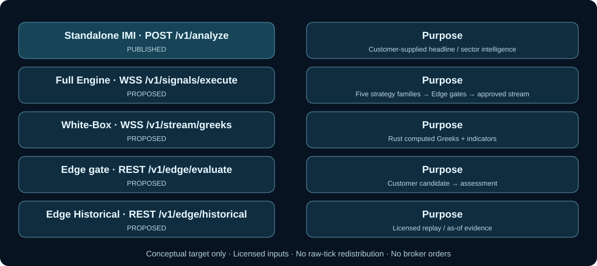
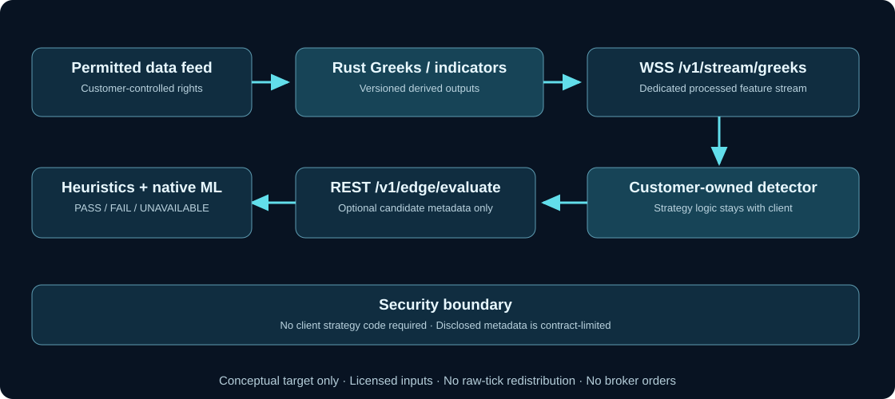
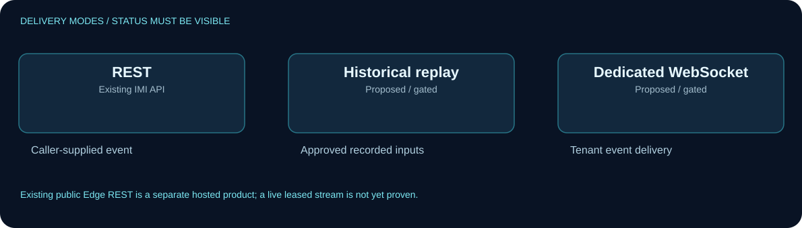
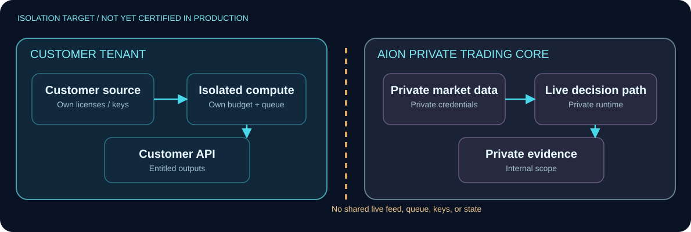
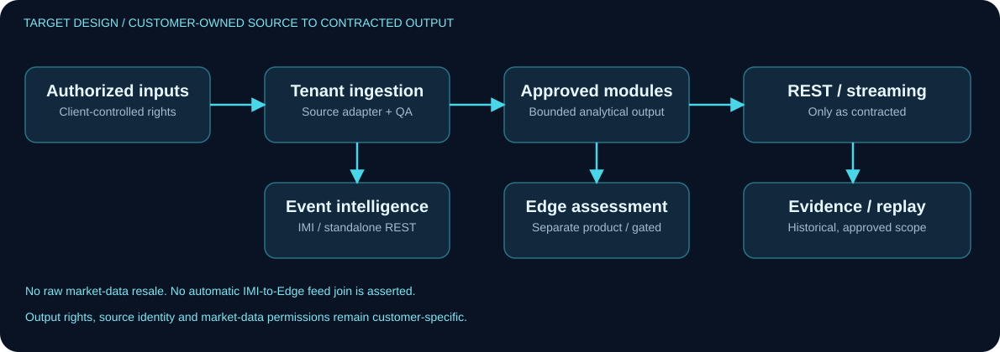
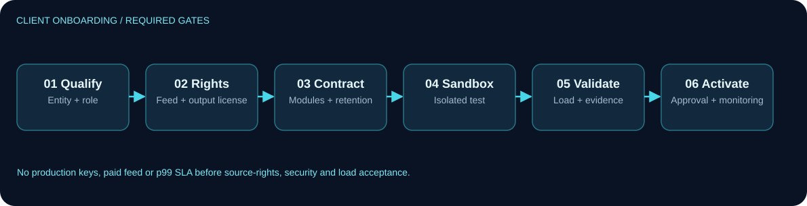

# AION Intraday Infrastructure

**Multi-layer institutional intraday trading infrastructure, financial market intelligence and quantitative analytics for professional integrations.**

[Institutional enquiries](https://aionanalytics.in/contact) | [AION Analytics](https://aionanalytics.in) | [Published IMI API](https://aionanalytics.in/models/indian-market-intelligence) | [Edge Engine](https://aionanalytics.in/models/edge-engine)

> **Access:** For professional developers, eligible institutional technology teams, and verified SEBI-registered Research Analysts (RAs) and Investment Advisers (IAs), subject to use-case review, source licensing, entitlement checks and contract. **Not a retail product.** This repository contains public capability documentation, not executable engine source code.
>
> **Service readiness:** The independent leasing platform, full signal stream, White-Box stream and private deployment options are proposed and release-gated. They are not represented as active or generally orderable production services. Existing standalone IMI is separately published.

## The product in one sentence

AION is engineering a bounded pipeline that turns **customer-authorized market inputs** into processed indicators, Greeks, strategy candidates, risk-gated analytical outputs and source-aware evidence. Clients consume approved outputs rather than AION redistributing exchange ticks.

The system combines input normalization, a Rust compute layer, five planned proprietary strategy families, Edge Heuristics, a native Edge ML stage, rights checks, and institutional delivery controls. These are distinct modules with independent readiness gates. The complete leased system has not yet been certified end to end.

**Why this matters:** Professional quant and technology teams can evaluate a modular, controlled institutional stack without designing every data adapter, analytical interface and delivery component themselves. AION combines multiple specialized systems and contract-level boundaries; it does not claim that the full commercial lease is already certified, live or failure-free. Pricing and rights depend on approved modules and deployment topology.

## Architecture at a glance

*Target Full Engine flow. Shows process boundaries, not a certified latency path or released endpoint.*

*Routes are labelled by their published or proposed status. Naming an interface does not make it live.*

### Six commercial pathways

| Path | Intended service | Commercial status |
| --- | --- | --- |
| Standalone IMI | REST news/event intelligence from customer-supplied headlines | Published separately; Builder INR 999/month, Professional INR 4,999/month, subject to current marketplace entitlements |
| Historical Edge | Authorized historical Edge replay | Proposed; part of Professional / Quant Research concept |
| Intraday IMI | Licensed event capture, real-time interpretation and bounded streaming | Proposed institutional service; from INR 249,000/month indicative |
| Live Edge | Risk and edge evaluation for approved customer workflows | Existing index-option Edge REST product is separate; new institutional live integration is proposed |
| White-Box Lease | Processed Greeks and indicators, plus optional Edge second gate, with customer-owned strategy | Proposed, custom quotation |
| Full Engine Lease | Rust compute, five strategy families, Heuristics, native ML, approved signal delivery | Proposed baseline INR 500,000/month; indices and three commodity categories subject to acceptance |

These are different commercial and technical contracts, not six current production feeds. All prices are subject to current published plans or a signed custom agreement; custom pricing is not an online purchase entitlement.

## Public capability map (no proprietary methods)

| Layer | Purpose | Boundary |
| --- | --- | --- |
| Customer source adapter | Ingests only independently authorized feeds and events | No resale or public redistribution of source market data |
| Normalization | Maintains instrument identity, source timestamps and validity | Missing, stale and nonfinite inputs must remain visible |
| Rust compute | Computes supported Greeks and indicators on permitted inputs | Formulae, internal optimizations and thresholds are not disclosed |
| Strategy families S1-S5 | Evaluate distinct intraday patterns | Public categories only; exact internal mapping must be confirmed before contract |
| Edge Heuristics | Applies a separate candidate review gate | No public disclosure of parameters or rules |
| Native Edge ML | Adds a bounded second assessment stage | No model weights or internal inference details |
| Rights and tenant controls | Enforce entitlement, output scope, revocation and isolation | Commercial tenant isolation requires deployment acceptance |
| REST / WebSocket delivery | Delivers approved derived information and versioned evidence | Proposed institutional streams are not active public endpoints |

### Strategy families, public taxonomy

1. **S1 - Intraday Momentum:** Trend continuation.
2. **S2 - Mean Reversion:** Fading extremes.
3. **S3 - Volatility Breakout:** Trading range expansion.
4. **S4 - Greeks Scalping:** Delta, Gamma and Theta driven options analysis.
5. **S5 - Event-Driven:** Earnings, macro releases and order-flow context.

The categories above are the founder-approved proposed public taxonomy. This page does not establish a verified one-to-one mapping to internal strategy IDs or validate availability for each instrument. Per-tenant family enablement and weighting remain proposed contractual configuration features.

## White-Box leasing

**Keep your own detector and strategy source private.** An approved White-Box deployment would provide processed Greeks, indicators and optional Edge evaluation while your proprietary detector remains in your environment.

The optional second gate receives only contractually defined candidate attributes. It is not a zero-knowledge protocol and should not be described as revealing no information whatsoever.

For latency-sensitive use, a public REST round trip cannot be assumed to meet a sub-10 ms requirement. BYOC or on-premises co-location is a deployment option to test, not a currently certified performance guarantee.

## Deployment models under consideration

| Deployment | Proposed arrangement | Status |
| --- | --- | --- |
| AION Hosted | Dedicated isolated customer resources with approved network access and a signed service schedule | Design option; tenant acceptance required |
| Bring Your Own Cloud (BYOC) | Versioned engine image deployed into an approved customer AWS, Azure or GCP private network | Design option; image, region, secrets and audit controls unverified for general release |
| On-Premise | Dedicated customer-controlled Linux or Mac Studio system with permitted feed connectivity | Design option; hardware, integration and latency must be tested per customer |

No arrangement grants title to the engine's source code, strategy logic, weights, market data or customer brokerage account. Exact custody, support access, encryption, audit logging, incident response and retention controls must be written into the customer agreement.

## API map and release status

| Method and path | Purpose | Status |
| --- | --- | --- |
| `POST /v1/analyze` | Customer-supplied news headline to event/sector analysis | Published standalone IMI API; see official product docs |
| `WSS /v1/signals/execute` | Approved Full Engine signal stream after strategy and Edge gates | Proposed only; route does not place broker orders |
| `WSS /v1/stream/greeks` | Dedicated stream of licensed, processed Greeks and indicators | Proposed only |
| `REST /v1/edge/evaluate` | Candidate reviewed by Edge Heuristics and native ML | Proposed only; not the existing public Edge snapshot/predict API |
| `REST /v1/edge/historical` | Reproducible licensed Edge replay | Proposed only |

Do not construct a WebSocket hostname from this table or assume any new route is accessible. Authentication, rate limits, schemas, reconnect semantics and service levels require a signed product-specific contract. See [the public contract summary](docs/API_AND_STATUS.md).

## What the diagrams establish

These diagrams describe the intended control and data flow. They are not architecture certification, source licenses, proof of completed tenant isolation or independently verified performance.

## Engineering and performance disclosure

AION's intraday work combines Rust-based analytical computation, independent research components, regulated-use boundaries and planned institutional delivery. Internal component and synthetic tests are not evidence of customer-level end-to-end throughput, guaranteed availability or live service capacity.

For a proposed institutional deployment, AION and the customer must agree on a documented test workload, source rights, deployment location, recovery behavior, output contract and latency measurement points. No production latency or throughput guarantee is advertised here. Any service level is effective only after an accepted benchmark and a signed Institutional SLA.

See [release readiness and benchmark policy](docs/RELEASE_AND_BENCHMARKS.md).

## Strict market-data policy

**AION does not sell, sublicense, rent, publish, distribute, redistribute, or otherwise make available raw exchange tick data, order book messages, private broker feeds, raw quote streams, or copies or samples of those data, whether for payment, free evaluation, testing, demonstration, resale, or any other purpose.**

A customer must independently source and maintain all required rights to the data it supplies, including applicable non-display, automated processing and derived-output rights. Providing a broker login, market-data subscription or SEBI registration does not itself prove permission to redistribute or commercialize the source data or derived outputs. AION supplies only contractually approved processed or analytical information and may decline an output where rights cannot be established.

This is a product policy, not a grant of rights over exchange, vendor or broker data. The relevant exchange or vendor agreement, applicable law and customer permissions control. See [market-data and confidentiality policy](docs/DATA_RIGHTS_AND_PRIVACY.md) and [NSE policy](https://www.nseindia.com/static/market-data/nse-data-policy).

## Who can request access

The institutional leasing offering is directed to **professional developers acting for eligible clients, SEBI-registered RAs and IAs whose registrations are verified, and appropriately authorized institutional or broker technology teams**. Retail investors, anonymous signal subscribers and unmanaged public trading bots are outside the intended service scope.

Registration, corporate status or technical experience does not alone establish data rights, authorization to give advice, approval for algorithmic execution or permission to redistribute outputs. AION is not supplying a retail trade-call service.

## Privacy and confidentiality

The design aims for strict tenant separation, minimal data access, customer-controlled keys where contracted, separate compute and storage, output authorization, limited retention and verifiable access logs. **These safeguards are architectural requirements, not blanket claims that every configuration is already independently certified.**

AION does not require a White-Box client to disclose its detector source code. Optional Edge calls still disclose the minimum contractually defined signal metadata necessary for evaluation. Any customer-specific retention, support access and disclosure rights must be agreed in writing.

## Risk, advice and execution disclaimer

All outputs are technical research and decision-support inputs, not an assurance of market performance. They are not fraud findings, credit ratings, guaranteed profitability, individualized investment advice or a recommendation to buy or sell. AION does not place broker orders merely by publishing a signal. Customers remain responsible for regulatory status, research/advice obligations, exchange and broker permissions, order execution, risk controls, account credentials and their own downstream use.

No representation is made that any proposed module or interface is approved by SEBI, NSE, BSE, MCX or any third-party data provider. Final regulatory and contract language is subject to jurisdiction-specific review.

## Areas of professional application

The documented platform direction covers institutional financial technology, quantitative research infrastructure, intraday options analytics, derivatives and Greeks processing, market event intelligence, event-to-sector APIs, algorithmic trading risk controls, licensed signal interfaces, historical strategy evaluation, managed analytics, low-latency system design, dedicated WebSocket delivery, REST integration, multi-tenant access control and private-cloud deployment. These terms describe application domains, not claims of universal support, exchange approvals or currently available endpoints.

## Commercial contact

For an institutional evaluation, send a use-case summary, entity and professional status, proposed source license, asset class, expected message rate, latency requirement and deployment preference to [contact@aionanalytics.in](mailto:contact@aionanalytics.in).

Website: [aionanalytics.in](https://aionanalytics.in)

## Repository scope and rights

This repository is documentation-only. It intentionally contains no source code, strategy formulas, model weights, credential material, actual raw market ticks, licensed feed samples or client data. The proprietary engine and any associated intellectual property are not licensed by this documentation. Specific technology rights and commercialization permissions depend on the applicable ownership and licensing arrangements.

The materials are for technical evaluation and product discussion only. No license to code, trademarks, market data, market-data redistribution, advice or live execution is granted. All rights reserved except where an express written license states otherwise.

Last reviewed: 12 November 2026. Statements labelled proposed are not declarations of generally available service.